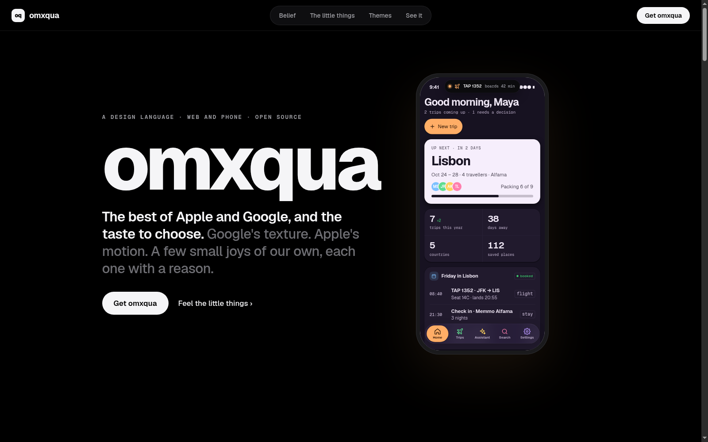
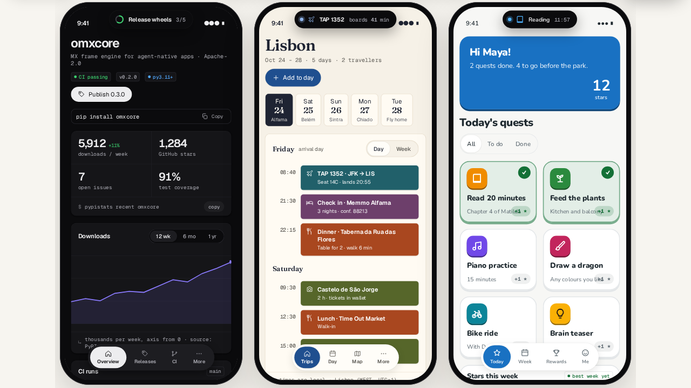

<div align="center">

# 🫧 omxqua

### every touch, a tiny joy.

**👉 [See it live: abhisheksreesaila.github.io/omxqua](https://abhisheksreesaila.github.io/omxqua/) 👈**

Press things. They press back. Best on a phone. 📱

[](https://abhisheksreesaila.github.io/omxqua/)

[🎛️ the showcase](https://abhisheksreesaila.github.io/omxqua/docs/showcase.html) · [🖼️ landing layouts](https://abhisheksreesaila.github.io/omxqua/docs/landing.html) · [📜 changelog](CHANGELOG.md) · MIT

</div>

---

## 💡 Why

Most apps feel like forms. I want mine to feel like toys that do serious work.

omxqua is the design language I use for every app I build, on the phone and on the web. It's **touch-native**: every button squishes and springs back, switches stretch when you hold them, and live things sit in a little black pill up top that grows when something's happening.

It's just my taste, borrowed honestly and rebuilt from scratch:

| from | we took | we left |
|---|---|---|
| 🍎 Apple | springs, motion with weight, a live pill up top | the glass, the fonts, the names |
| 🤖 Google | solid tonal surfaces, one soft shadow, floating labels | the ripples |
| 💻 the terminal | mono numbers, the command behind each card (dev apps only) | the green-on-black |

Plain HTML, CSS and JS. No framework, no build step, 16 KB gzipped (plus fonts).

## 🎨 One feel, three families

[](https://abhisheksreesaila.github.io/omxqua/#apps)

| family | for | vibe |
|---|---|---|
| 🛠️ **Developer** · Graphite | libraries, packages, consoles | ink on near-black, compact, mono numbers |
| ✈️ **Travel** · Coast | trips, places, days | sand and sea, skins Azulejo 🔷 and Golden hour 🌅 |
| 🧸 **Kids** · Playground | children's apps | cream and tangerine, big targets, skins Sticker and Crayon 🖍️ |
| 💳 **Money** · Ledger | accounts, spending, budgets | near-black or cool paper, one violet accent, every amount in mono |

<a id="use-it"></a>
## 🤖 Hand it to your agent

You describe the screen. Your agent builds it in omxqua.

### Claude Code: one line

```
/plugin install omxqua --marketplace abhisheksreesaila/omxqua
```

Then just ask: *"a trip planner home screen in omxqua"*. The skill makes Claude read the reference, pick a family, use the real parts and check it on a phone-sized screen.

<sub>Older Claude Code: `/plugin marketplace add abhisheksreesaila/omxqua`, then `/plugin install omxqua@omxqua`.</sub>

### Codex, Cursor, or any agent that reads skills

Copy [`skills/omxqua/`](skills/omxqua/SKILL.md) into its skills folder. Done.

### Anything else (ChatGPT, v0, Lovable…): paste this

```text
Build this UI in omxqua, a touch-native design language (Material texture, Liquid motion).
Before writing any markup, read the reference:
https://raw.githubusercontent.com/abhisheksreesaila/omxqua/main/AGENTS.md
Link these four files in this order, pinned to a tag:
https://cdn.jsdelivr.net/gh/abhisheksreesaila/omxqua@v0.1.5/src/fonts.css
https://cdn.jsdelivr.net/gh/abhisheksreesaila/omxqua@v0.1.5/src/tokens.css
https://cdn.jsdelivr.net/gh/abhisheksreesaila/omxqua@v0.1.5/src/components.css
https://cdn.jsdelivr.net/gh/abhisheksreesaila/omxqua@v0.1.5/src/omxqua.js (defer)
Put the root classes on <html>: oq-root, oq-light or oq-night, a family
(oq-family-dev for tools, oq-family-travel for trips, oq-family-kids for children, oq-family-money for money apps),
and oq-top for the top-island shell. Use only the classes and --oq-* tokens in the
reference. One filled button per card, no glass, no gradients, no emoji icons,
no :active scale rules. Check it at 390 px wide and on desktop, in light and night.

What I want: <describe the screen>
```

## ✋ By hand

Four links and a class:

```html
<link rel="stylesheet" href="https://cdn.jsdelivr.net/gh/abhisheksreesaila/omxqua@v0.1.5/src/fonts.css">
<link rel="stylesheet" href="https://cdn.jsdelivr.net/gh/abhisheksreesaila/omxqua@v0.1.5/src/tokens.css">
<link rel="stylesheet" href="https://cdn.jsdelivr.net/gh/abhisheksreesaila/omxqua@v0.1.5/src/components.css">
<script src="https://cdn.jsdelivr.net/gh/abhisheksreesaila/omxqua@v0.1.5/src/omxqua.js" defer></script>

<html class="oq-root oq-light oq-family-travel oq-top">
```

Then build with the parts in [AGENTS.md](AGENTS.md). The CDN is for trying it; when you ship, copy `src/` and `fonts/` into your project (more below).

---

<details>
<summary><b>📦 Shipping it in a real project</b></summary>

Vendor the files so nothing loads from a third party. Copy `src/` and `fonts/` side by side, or from a clone:

```sh
bin/omxqua-sync static/                 # -> static/omxqua/{src,fonts,VERSION}, latest tag
bin/omxqua-sync static/ --ref v0.1.5    # a specific tag
```

```html
<link rel="stylesheet" href="/static/omxqua/src/fonts.css">
<link rel="stylesheet" href="/static/omxqua/src/tokens.css">
<link rel="stylesheet" href="/static/omxqua/src/components.css">
<script src="/static/omxqua/src/omxqua.js" defer></script>
```

The root element also needs `container-type: inline-size; position: relative`. Theme `oq-night | oq-light`, family `oq-family-dev | travel | kids | money`, optional skin `oq-skin-azulejo | golden` (travel) or `sticker | crayon` (kids), shell `oq-top` (default) or `oq-dock`.

</details>

<details>
<summary><b>🗂️ What's in the repo</b></summary>

```
src/tokens.css       every --oq-* value: core, themes, families, skins, accents
src/components.css   every reusable part, scoped under .oq-root
src/fonts.css        @font-face for Geist, Geist Mono, Fraunces, Nunito
src/omxqua.js        press, the self-writing logo, motion helpers (window.Omxqua)
fonts/               the four variable woff2 files and their licences
docs/index.html      the cover (the live site)
docs/showcase.html   Contoso: one app in every theme, web + phone, all the parts
docs/kit-v1.html     the earlier three-app kit (every family, skin and shell)
docs/landing.html    the landing layer: Statement, Editorial, Bento
AGENTS.md            the reference agents (and people) build from
LANGUAGE.md          the rules and why
skills/omxqua/       the skill agents load
.claude-plugin/      Claude Code plugin + marketplace manifests
bin/omxqua-sync      copies src/ and fonts/ at a tag into another project
review/              the 2026-10-20 Google Stitch review
```

To open the docs pages locally, serve the repo root (`python3 -m http.server`); they don't work as files.

</details>

<details>
<summary><b>🏷️ Versions and licences</b></summary>

Semver tags, every change in [CHANGELOG.md](CHANGELOG.md). Renaming or removing a token, class or helper is a breaking change, so pin a tag.

- Code (CSS, JS, docs, scripts): MIT, see [LICENSE](LICENSE).
- Fonts: Geist and Geist Mono (Vercel), Fraunces and Nunito (their authors), each under the SIL Open Font License 1.1. Their licence files sit next to them in `fonts/`; MIT doesn't cover them.
- No Apple or Microsoft fonts, icons or names. Ours are the Beacon, the nav island and Settle.

</details>

<div align="center">

made with springs 🌀 · take what you like

</div>
